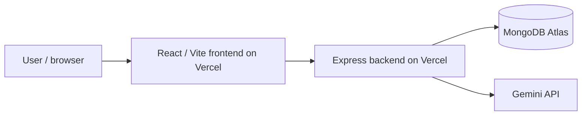

# Campus Study Room Reservation System

[](https://github.com/amseph/itelect4-project/actions/workflows/ci.yml)

The Campus Study Room Reservation System is a React web application for students to browse study rooms, create an account or sign in, and manage study room reservations. Its AI Study Assistant (AI Review page) reviews a proposed study plan and provides practical feedback before a reservation.

## Features

- Browse study rooms and view room details.
- Register, authenticate, and log out.
- Create reservations and view persisted reservation records.
- Use the AI Study Assistant to review a study plan.

## Technology Stack

- React and TypeScript with Vite
- Tailwind CSS and React Router
- TanStack Query, Zustand, React Hook Form, and Zod
- Express backend, MongoDB Atlas, and Gemini API

## Architecture



## Local Setup

Requirements: Node.js 24 and npm.

Install dependencies:

```bash
npm ci
```

Set `VITE_API_URL` in a local `.env` file to the backend API base URL. For example:

```env
VITE_API_URL=https://itelect4-backend-flame.vercel.app
```

Run the frontend locally:

```bash
npm run dev
```

Run frontend tests:

```bash
npm test
```

Lint and create a production build:

```bash
npm run lint
npm run build
```

The frontend tests use a fake test-only `VITE_API_URL` from `vite.config.ts`; they do not require a GitHub secret or call the deployed API.

## Live Deployment

- Frontend: [https://itelect4-project-chi.vercel.app](https://itelect4-project-chi.vercel.app)
- Backend API: [https://itelect4-backend-flame.vercel.app](https://itelect4-backend-flame.vercel.app)

## Backend Repository

[https://github.com/amseph/itelect4-backend](https://github.com/amseph/itelect4-backend)

## AI Use Disclosure

AI tools were used for development assistance, debugging, and code review. All changes were reviewed, tested, and understood by the author.
