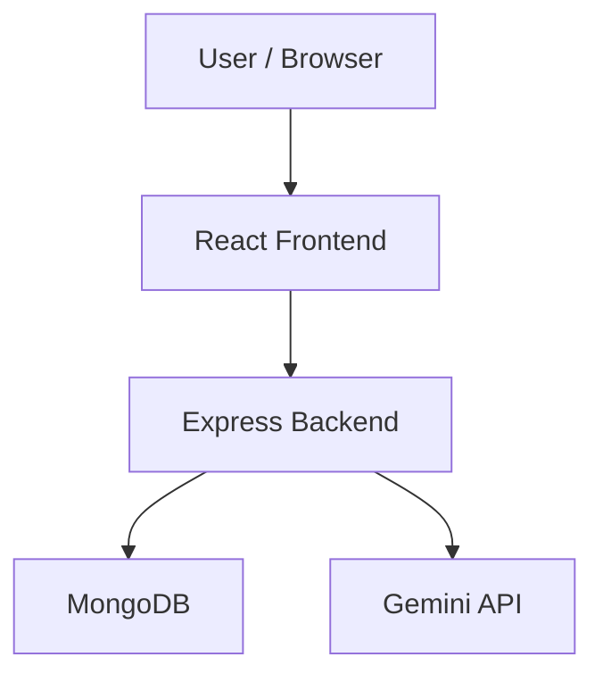

# Campus Study Room Reservation System

[](https://github.com/amseph/itelect4-project/actions/workflows/ci.yml)

## About

A web application where students can browse study rooms, create and manage reservations, and use the AI Study Assistant to review a study plan.

## Features

- Register and log in
- Browse study rooms and view room details
- Create and manage study room reservations
- Use the AI Study Assistant to review a study plan

## Tech Stack

React, TypeScript, Vite, and Tailwind CSS. The frontend connects to the project's Express backend.

## Architecture



The user interacts with the React frontend. The frontend sends requests to the Express backend. The backend handles data through MongoDB and communicates with Gemini for the AI feature.

## Local Setup

1. Install dependencies:

   ```bash
   npm ci
   ```

2. Create a local `.env` file and set `VITE_API_URL` to the backend API base URL.
3. Start the frontend:

   ```bash
   npm run dev
   ```

## Testing

```bash
npm test
npm run lint
npm run build
```

## Live Deployment

- Frontend: [https://itelect4-project-chi.vercel.app](https://itelect4-project-chi.vercel.app)
- Backend API: [https://itelect4-backend-flame.vercel.app](https://itelect4-backend-flame.vercel.app)

## Backend Repository

[https://github.com/amseph/itelect4-backend](https://github.com/amseph/itelect4-backend)

## AI Use Disclosure

AI tools were used for development assistance, debugging, and code review. All changes were reviewed, tested, and understood by the author.
